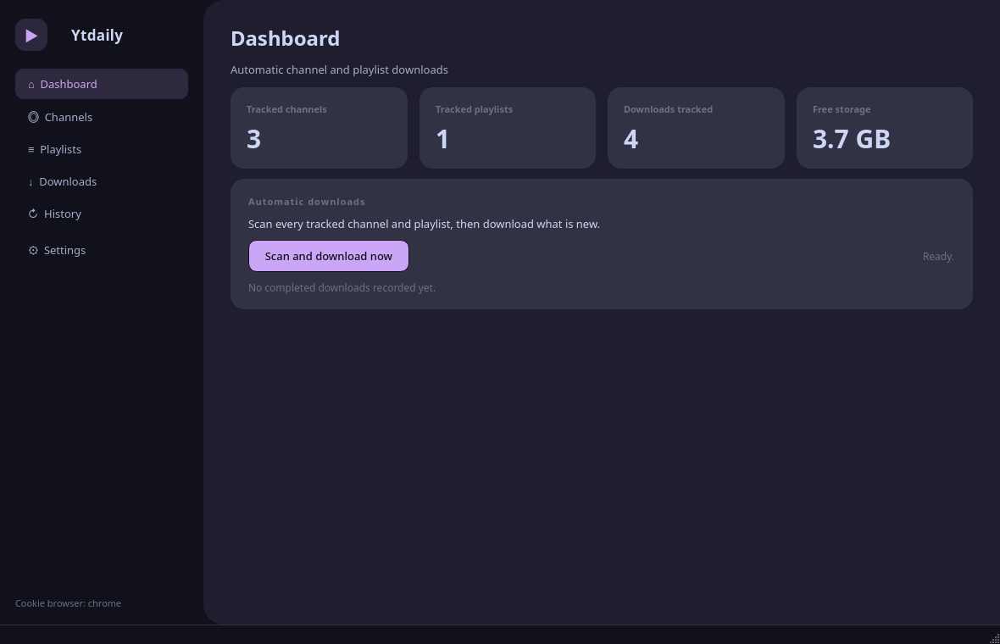
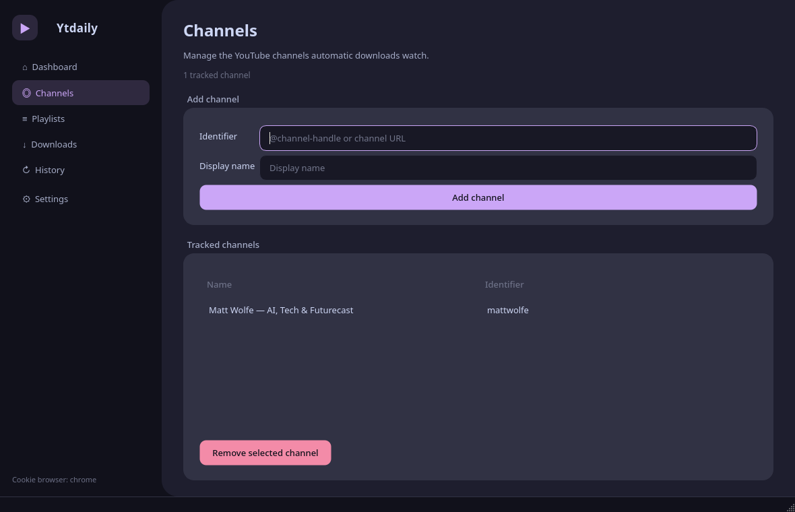
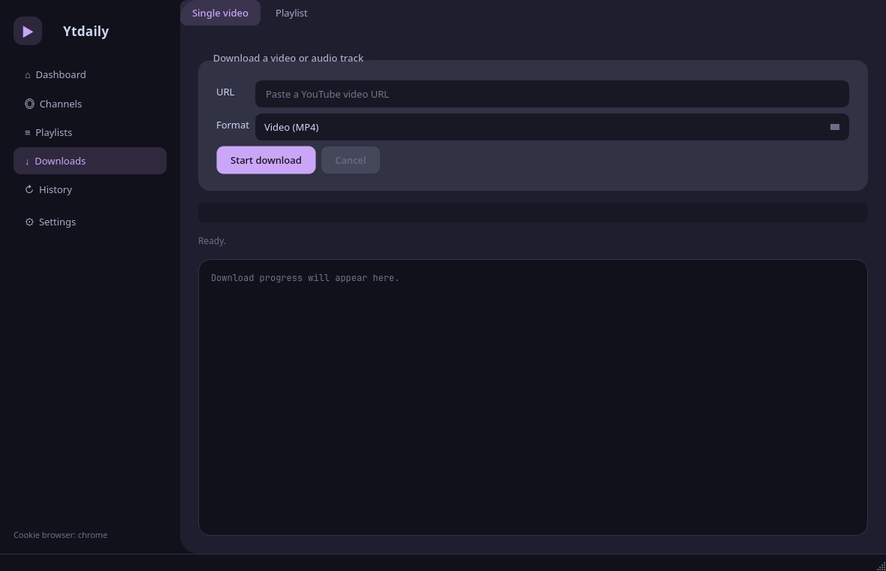
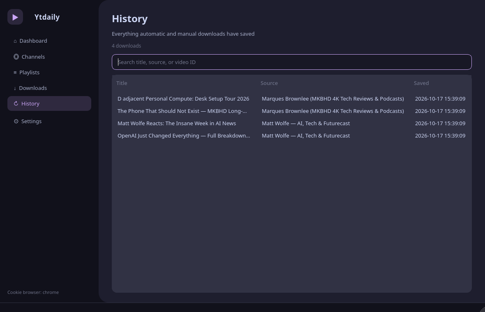
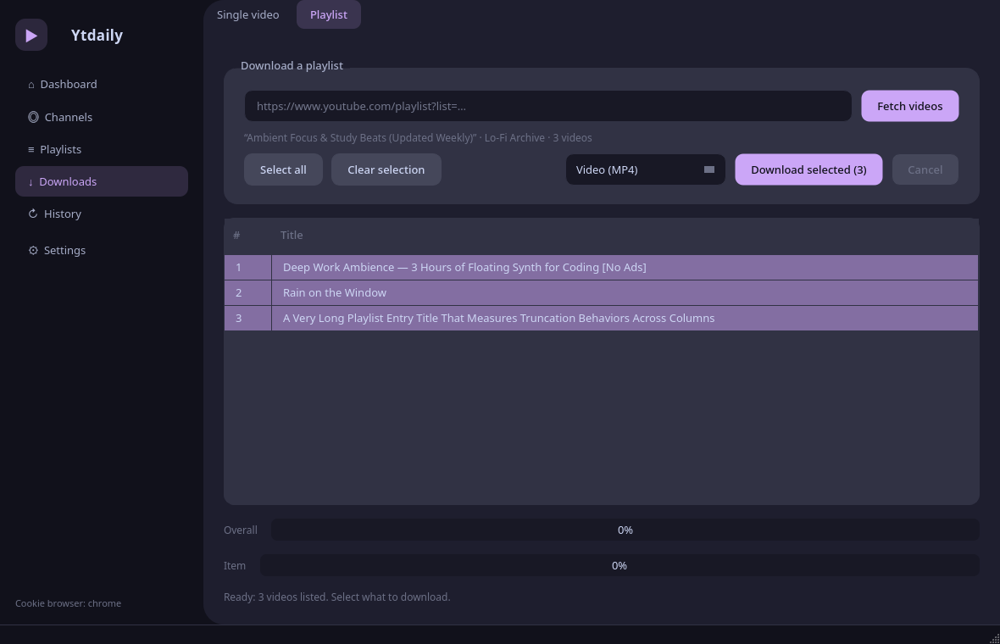
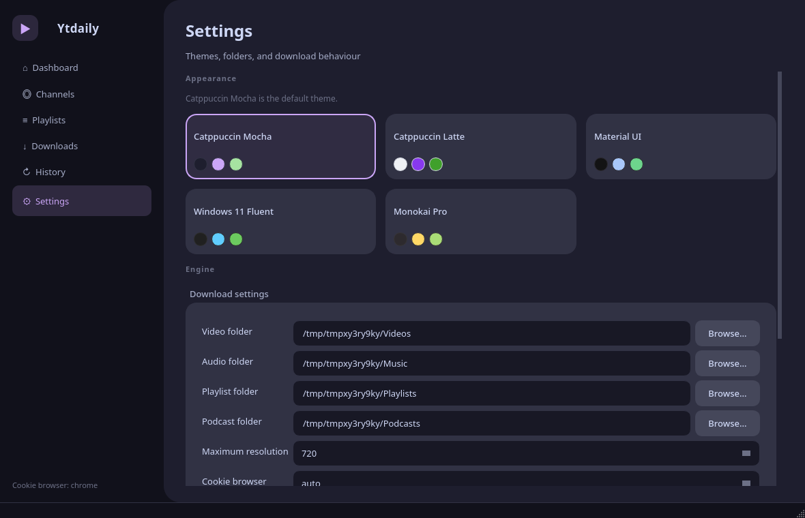
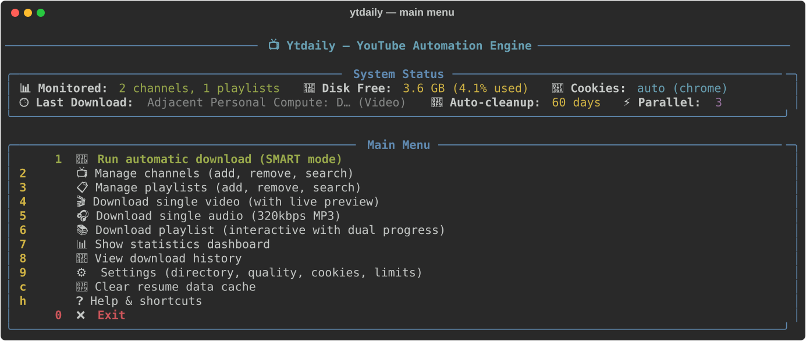
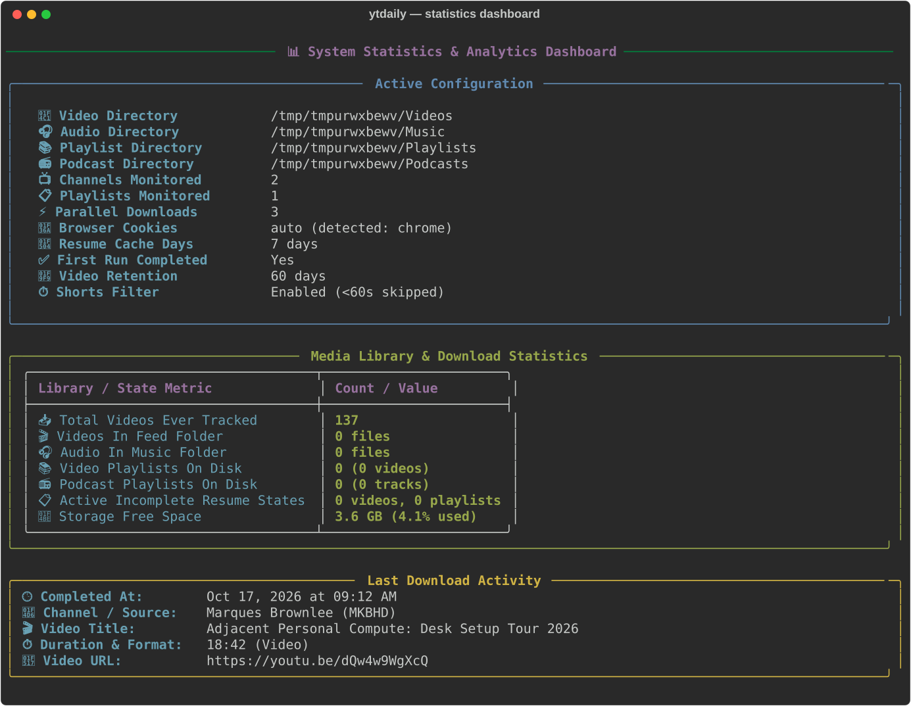

<div align="center">

  

  # 📺 Ytdaily

  **The Universal Media Automation & Multi-Platform Feed Downloader**

  *Transform your machine into a smart, silent personal media hub with zero duplicate downloads.*

  [](LICENSE)
  [](https://www.python.org/downloads/)
  [](https://www.python.org/)
  [](https://pyside.org)
  [](https://github.com/yt-dlp/yt-dlp)

  <p align="center">
    <a href="#-key-features">Features</a> •
    <a href="#-supported-platforms">Supported Platforms</a> •
    <a href="#-visual-tour">Visual Tour</a> •
    <a href="#-how-it-works-architecture">Architecture</a> •
    <a href="#-get-started">Installation</a> •
    <a href="#-desktop-gui--windows">Desktop GUI</a> •
    <a href="#-automation-engine-systemd">Automation</a>
  </p>

</div>

---

## 🌟 Overview

**Ytdaily** is a high-performance, interactive media automation engine and downloader built for creators, archivists, and enthusiasts. It quietly monitors your favorite content feeds, channels, and playlists, automatically synchronizing newly published media in crystal-clear quality up to 4K, scrubbing sponsors, extracting high-fidelity audio (320kbps MP3), and maintaining a state-based database so you never download duplicates.

Whether you prefer a gorgeous **PySide6 desktop GUI** (themed with Catppuccin Mocha) or a lightning-fast **Rich Terminal UI (TUI)**, Ytdaily gives you seamless control over single downloads, batch collections, and continuous 24/7 background automation.

---

## 🌐 Supported Platforms

Ytdaily features universal video and audio extraction powered by `yt-dlp`:

| Platform | Streams & Feeds | Video Formats | Audio Only | SponsorBlock |
| :--- | :---: | :---: | :---: | :---: |
| **YouTube** | Channels, Playlists, Shorts, URLs | Up to 4K (2160p) | 320 kbps MP3 | ✅ Built-in |
| **TikTok** | User Profiles, Video Links | Best progressive MP4 | 320 kbps MP3 | N/A |
| **Instagram** | Reels, Stories, Video Posts | Best progressive MP4 | 320 kbps MP3 | N/A |
| **Twitter / X** | Status Clips, Media Tweets | Best progressive MP4 | 320 kbps MP3 | N/A |
| **Facebook** | Watch, Reels, Page Videos | High Definition MP4 | 320 kbps MP3 | N/A |
| **Web Video** | Direct URLs & 1,000+ Providers | Adaptive Streams & MP4 | 320 kbps MP3 | N/A |

---

## ✨ Key Features

- ⚡ **Multi-Threaded Parallel Downloads**: Download multiple streams simultaneously with intelligent bandwidth distribution.
- 🎯 **Configurable Quality**: Select resolutions from 360p to 4K (2160p) with automatic format fallbacks.
- 🛡️ **SponsorBlock Scrubbing**: Automatically cuts sponsors, intro cards, interaction reminders, and filler segments from supported video feeds.
- 🍪 **Seamless Browser Authentication**: Auto-detects session cookies from Brave, Chrome, Chromium, Firefox, Edge, Opera, or Vivaldi.
- 📻 **Podcast Automation**: Automatically converts monitored audio feeds into pristine 320kbps MP3s with embedded album art.
- 🧠 **Smart Gap Detection**: JSON-backed state tracking keeps an exact history of every video encountered to ensure zero duplicate downloads.
- 🧹 **Self-Cleaning Retention**: Configurable auto-cleanup automatically purges files older than your retention policy (default: 60 days).
- 🎨 **Dual Interface**: Switch effortlessly between the Catppuccin Mocha PySide6 desktop application and the rich command-line TUI.

---

## 🖼️ Visual Tour

### 🖥️ Desktop GUI (PySide6)

The desktop app comes loaded with a Catppuccin Mocha dark theme (switchable from five built-in palettes in Settings), complete with searchable history, playlist entry selectors, and background workers.

| Dashboard | Source Tracking |
| :---: | :---: |
|  |  |

| One-Off Downloads (MP4 / MP3) | Searchable History |
| :---: | :---: |
|  |  |

| Playlist Selective Picker | Themes & Preferences |
| :---: | :---: |
|  |  |

---

### 💻 Terminal UI (Rich TUI)

| Main Menu | Statistics Dashboard |
| :---: | :---: |
|  |  |

| Automated Configuration Scan | Live Gap Detection |
| :---: | :---: |
|  |  |

| Parallel Download Progress | Detailed Media Info |
| :---: | :---: |
|  |  |

---

## 🛠️ How it Works: Architecture

<p align="center">
  
</p>

Ytdaily operates on a **Silent Automation** philosophy:

```
[ Scheduled Trigger / GUI ] ───► [ Intelligent Scanner ] ───► [ Gap Signature Match ]
                                                                       │
[ Download Complete ] ◄─── [ SponsorBlock / Subtitles ] ◄─── [ Multi-Threaded Engine ]
```

1. **Intelligent Monitor**: Scans your configured creators, channels, and playlists, querying metadata using lightweight flat-playlist requests.
2. **Signature Comparison**: Checks video IDs against your local state database (`~/.local/share/Ytdaily/channel_history.json`) to isolate new uploads.
3. **Parallel Processing**: Dispatches download tasks through a managed `ThreadPoolExecutor` with real-time speed, progress, and ETA reporting.
4. **Post-Processing & Scrubbing**: Automatically embeds chapters and subtitles, removes sponsor segments, and standardizes container formats.

<p align="center">
  
</p>

---

## 🚀 Get Started

### Linux (Debian, Ubuntu, Fedora, Arch)

The automated installer checks dependencies, isolates Python environments (PEP 668 compliant), sets up directories, injects shell aliases, and registers the systemd service.

```bash
git clone https://github.com/BikramGole/Ytdaily.git
cd Ytdaily
chmod +x install.sh
./install.sh
```

#### What the installer configures:
- Installs `yt-dlp`, `ffmpeg`, and `python-rich` using your distribution's native package manager.
- Initializes workspace directories in `~/.local/share/Ytdaily/`.
- Injects `ytdaily` and `ytdaily-gui` aliases into `bash`, `zsh`, or `fish`.
- Installs desktop menu entries and scalable application icons.
- Enables the optional daily **Systemd Background Service**.

---

### ⏰ The Automation Engine (Systemd)

After installation on Linux, Ytdaily can run as a silent background service:

- **Schedule**: Executes once every 24 hours.
- **Boot Safety**: Automatically waits 5 minutes after system startup for stable network connectivity.
- **Resource Priority**: Operates with `Nice=19` and `IOSchedulingClass=idle` to ensure your system never stutters during work or gaming.

Manage the automation service at any time:
```bash
# Check status
systemctl --user status Ytdaily.service

# View live service logs
journalctl --user -u Ytdaily.service -f
```

---

### 🪟 Windows Setup

1. Install [Python 3.9+](https://www.python.org/downloads/) (check **"Add Python to PATH"**).
2. Install [FFmpeg](https://ffmpeg.org/download.html) and ensure `ffmpeg.exe` is in your system `PATH`.
3. Clone this repository and run the setup script:
   ```cmd
   git clone https://github.com/BikramGole/Ytdaily.git
   cd Ytdaily
   install_windows.bat
   ```
4. Launch the desktop GUI:
   ```cmd
   py -m ytdaily.main --gui
   ```

> [!TIP]
> To compile a standalone, single-file Windows executable, execute:
> ```powershell
> powershell -ExecutionPolicy Bypass -File scripts\build_windows.ps1
> ```

---

## ⚙️ Configuration & Customization

Ytdaily stores its configuration in `config.json` inside your application directory. You can edit settings directly in the TUI or GUI Settings panel:

| Setting | Default | Description |
| :--- | :---: | :--- |
| `max_resolution` | `720` | Target maximum video resolution (`360`, `480`, `720`, `1080`, `1440`, `2160`) |
| `max_parallel_downloads` | `3` | Number of simultaneous concurrent download streams |
| `cleanup_days` | `60` | Days to keep videos before automatic cleanup |
| `filter_shorts` | `true` | Skip vertical shorts (< 60 seconds) during automatic feed scans |
| `browser` | `auto` | Browser to extract authentication cookies from (`chrome`, `firefox`, `brave`, `edge`, etc.) |

---

## 🧰 Tech Stack

<p align="center">
  
  
  
  
  
</p>

---

## 📈 Star History

<a href="https://star-history.com/#BikramGole/Ytdaily&Date">
 <picture>
   <source media="(prefers-color-scheme: dark)" srcset="https://api.star-history.com/svg?repos=BikramGole/Ytdaily&type=Date&theme=dark" />
   <source media="(prefers-color-scheme: light)" srcset="https://api.star-history.com/svg?repos=BikramGole/Ytdaily&type=Date" />
   
 </picture>
</a>

---

## ⚖️ License

Distributed under the **MIT License**. See [`LICENSE`](LICENSE) for more information.
